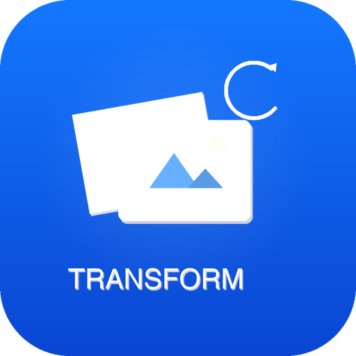
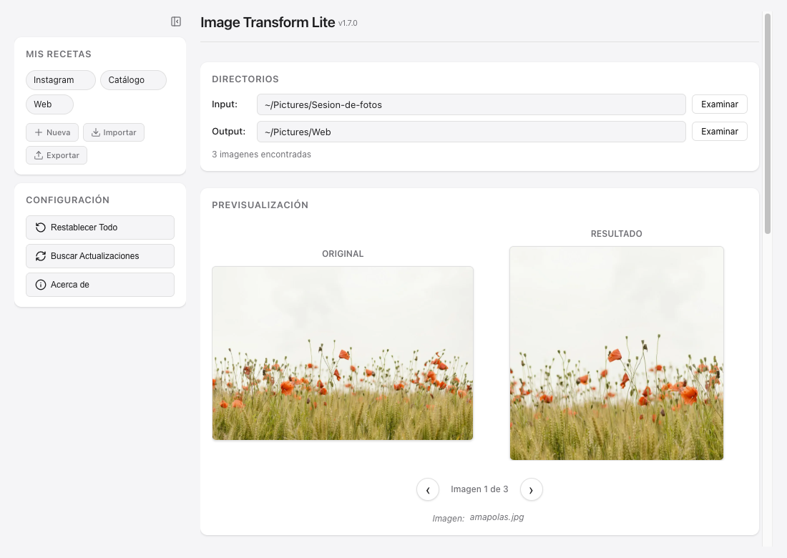
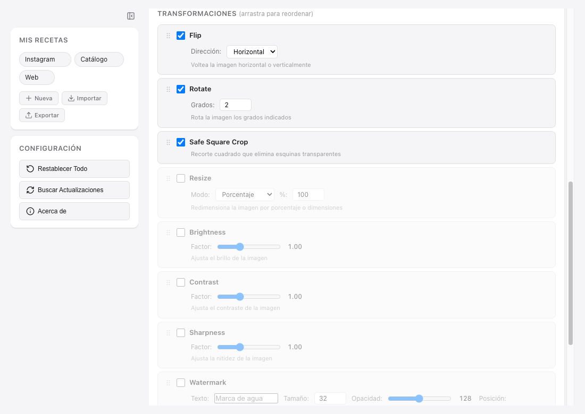
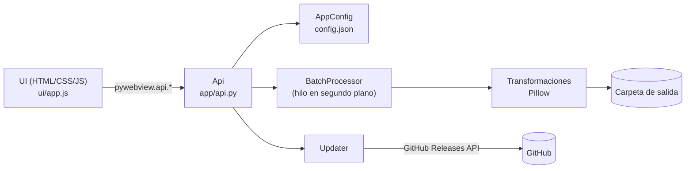

<a id="readme-top"></a>

<div align="center">



# Image Transform Lite

**Procesamiento de imágenes en lote para Mac, Windows y Linux, rápido y simple.**

8 transformaciones, vista previa en tiempo real y presets reutilizables.<br>
Gratis, open source y sin telemetría.

[](https://github.com/MAECLY/image-transform-lite/releases/latest)
[](https://github.com/MAECLY/image-transform-lite/releases)
[](https://github.com/MAECLY/image-transform-lite/actions/workflows/ci.yml)
[](LICENSE)
<br>
[](#-descargar)
[](https://www.python.org/)
[](https://github.com/MAECLY/image-transform-lite/stargazers)
[](https://hits.sh/github.com/MAECLY/image-transform-lite/)
[](https://github.com/MAECLY/image-transform-lite/commits/main)

[**Descargar**](#-descargar) · [Sitio web](https://image-lite.maecly.com) · [Novedades](CHANGELOG.md) · [Reportar un bug](https://github.com/MAECLY/image-transform-lite/issues/new) · [Pedir una función](https://github.com/MAECLY/image-transform-lite/issues/new)

<br>



</div>

<details>
<summary><strong>Tabla de contenidos</strong></summary>

- [Por qué Image Transform Lite](#-por-qué-image-transform-lite)
- [Descargar](#-descargar)
- [Cómo funciona](#-cómo-funciona)
- [Características](#-características)
- [Transformaciones](#-transformaciones)
- [Instalación](#-instalación)
- [Uso](#-uso)
- [Preguntas frecuentes](#-preguntas-frecuentes)
- [Privacidad](#-privacidad)
- [Desarrollo](#-desarrollo)
- [Hoja de ruta](#-hoja-de-ruta)
- [Contribuir](#-contribuir)
- [Licencia](#-licencia)
- [Agradecimientos](#-agradecimientos)

</details>

## ✨ Por qué Image Transform Lite

- **Ves el resultado antes de procesar.** La vista previa antes/después se actualiza con cada cambio, sin exportar nada.
- **Tú decides el orden.** Arrastra las tarjetas para reordenar el pipeline: rotar y luego recortar no es lo mismo que al revés.
- **Repite el trabajo con un click.** Guarda tus combinaciones como recetas y compártelas como archivos JSON.
- **Carpetas enteras, misma estructura.** Procesa subcarpetas de forma recursiva y conserva el árbol de directorios en la salida.
- **Funciona en todas partes.** Una ventana de escritorio real en macOS, Windows y Linux, en x64 y ARM64 (en Windows ARM64, mediante emulación x64). No hace falta navegador ni cuenta.

## 📦 Descargar

Descarga la [**última versión**](https://github.com/MAECLY/image-transform-lite/releases/latest) para tu sistema. En el [sitio web](https://image-lite.maecly.com/es#download) se detecta tu sistema automáticamente.

| Sistema | Arquitectura | Archivo | Requisitos |
|---|---|---|---|
| **macOS** | Apple Silicon (M1–M4) | `…-macos-arm64.pkg` (recomendado) · `…-macos-arm64.zip` | macOS reciente ² |
| **macOS** | Intel | `…-macos-x64.pkg` (recomendado) · `…-macos-x64.zip` | macOS reciente ² |
| **Windows** | x64 (Intel / AMD) | `…-windows-x64.zip` (portable) | Windows 10/11 de 64 bits + WebView2 |
| **Windows** | ARM64 (Snapdragon…) | `…-windows-arm64.zip` (portable) | Windows 11 ARM + WebView2 ¹ |
| **Linux** | x64 (amd64) | `…-linux-x64.tar.gz` | glibc 2.35+ (Ubuntu 22.04, Debian 12, Fedora 36+) |
| **Linux** | ARM64 (aarch64) | `…-linux-arm64.tar.gz` | glibc 2.35+ (Ubuntu 22.04, Debian 12, Fedora 36+) |

¹ El paquete de Windows ARM64 contiene una build x64 que Windows 11 ejecuta mediante su emulación integrada.

² La app no fija una versión mínima de macOS; las builds se generan en los runners de macOS actuales de GitHub Actions.

Todos los archivos se llaman `Image-Transform-Lite-<versión>-<sistema>-<arquitectura>.<extensión>`.

<details>
<summary>¿No sabes qué arquitectura tienes?</summary>

- **macOS:** menú Apple → *Acerca de este Mac*. «Chip Apple M…» es Apple Silicon; «Procesador Intel» es Intel.
- **Windows:** *Configuración → Sistema → Información*, mira «Tipo de sistema».
- **Linux:** ejecuta `uname -m`. `x86_64` es x64; `aarch64` es ARM64.

</details>

> [!NOTE]
> Cada release incluye también `Image-Transform-Lite-<versión>-arm64.zip`. Es una copia del zip de macOS Apple Silicon que existe solo para que las versiones 1.6 y anteriores puedan actualizarse solas. Si descargas a mano, usa los archivos de la tabla.

<p align="right"><a href="#readme-top">↑ volver arriba</a></p>

## 🚀 Cómo funciona

Cuatro pasos. Sin complicaciones.

1. **Importar.** Selecciona la carpeta con tus imágenes. Se buscan también en las subcarpetas.
2. **Configurar.** Activa las transformaciones que necesites y reordénalas arrastrando.
3. **Vista previa.** Mira el antes y el después en tiempo real con cada cambio.
4. **Exportar.** Procesa todo el lote a WebP, JPEG, PNG o TIFF conservando la estructura de carpetas.

## 🧰 Características

| | |
|---|---|
| 👁️ **Vista previa en vivo** | Antes/después en tiempo real (debounce de 150 ms) con navegación entre imágenes. |
| ↕️ **Drag-and-drop** | Reordena el pipeline de transformaciones arrastrando las tarjetas. |
| 🔖 **Recetas (presets)** | Guarda combinaciones con nombre; impórtalas y expórtalas como JSON. |
| 🗂️ **Procesamiento en lote** | Carpetas completas, recursivo, conservando la estructura de directorios. |
| 🖼️ **Multi-formato** | Lee JPG, PNG, WebP, BMP y TIFF. Exporta a WebP, JPEG, PNG o TIFF con calidad configurable. |
| 🔄 **Auto-actualización** | Detecta nuevas versiones en GitHub Releases y descarga el archivo de tu sistema y arquitectura (en Windows ARM64, el paquete x64, que es la misma build). |
| 🧭 **Sidebar colapsable** | Se reduce a iconos de 48 px con tooltips para ganar espacio. |
| 🔓 **Código abierto** | AGPL-3.0, auditable, sin telemetría y sin cuentas. |

## 🎛 Transformaciones

8 transformaciones, infinitas combinaciones. Se aplican en el orden que tú decidas.



| Transformación | Qué hace | Parámetros | Por defecto |
|---|---|---|---|
| **Flip** | Voltea la imagen | Horizontal / Vertical | Activado, horizontal |
| **Rotate** | Rota con fondo transparente | Grados (-360 a 360) | Activado, 2° |
| **Safe Square Crop** | Recorte cuadrado que elimina las esquinas transparentes tras rotar | Automático | Activado |
| **Resize** | Redimensiona | Porcentaje (10–500 %) o píxeles con aspect ratio opcional | Desactivado, 100 % |
| **Brightness** | Ajusta el brillo | Factor 0.5–2.0 | Desactivado, 1.0 |
| **Contrast** | Ajusta el contraste | Factor 0.5–2.0 | Desactivado, 1.0 |
| **Sharpness** | Ajusta la nitidez | Factor 0.0–3.0 | Desactivado, 1.0 |
| **Watermark** | Añade texto como marca de agua | Texto, tamaño, opacidad, posición (4 esquinas o centro) | Desactivado, 32 px, opacidad 128, abajo a la derecha |

<p align="right"><a href="#readme-top">↑ volver arriba</a></p>

## 💿 Instalación

<details open>
<summary><strong>macOS</strong></summary>

1. Descarga el `.pkg` de tu arquitectura (`macos-arm64` para Apple Silicon, `macos-x64` para Intel).
2. Ábrelo y sigue el instalador. La app queda en `/Applications`.
3. **Primera vez:** click derecho sobre la app → *Abrir*.

Alternativa: descarga el `.zip`, descomprímelo y mueve `Image Transform Lite.app` a `/Applications`.

> **Importante:** la app no está firmada con un certificado de Apple Developer, así que Gatekeeper puede bloquearla la primera vez. Si *click derecho → Abrir* no basta, quita la cuarentena desde Terminal:
>
> ```bash
> xattr -rd com.apple.quarantine "/Applications/Image Transform Lite.app"
> ```

</details>

<details>
<summary><strong>Windows</strong></summary>

1. Descarga el `.zip` de tu arquitectura (`windows-x64` o `windows-arm64`).
2. Descomprímelo donde quieras. Se crea la carpeta `Image Transform Lite\`.
3. Ejecuta `Image Transform Lite.exe`. No hace falta instalador.

> **Importante:** la app no está firmada, así que **SmartScreen** puede mostrar «Windows protegió tu PC». Pulsa *Más información* → *Ejecutar de todas formas*.

La interfaz usa Microsoft Edge **WebView2**, que ya viene con Windows 11 y con Windows 10 actualizado. Si la ventana no abre, instala el [WebView2 Runtime](https://developer.microsoft.com/microsoft-edge/webview2/).

</details>

<details>
<summary><strong>Linux</strong></summary>

```bash
tar -xzf Image-Transform-Lite-<versión>-linux-x64.tar.gz
cd image-transform-lite
./install.sh              # añade la app al menú de aplicaciones (~/.local/share/applications)
./image-transform-lite    # o ábrela desde el menú
```

Para quitarla del menú: `./uninstall.sh`.

La interfaz usa Qt WebEngine. En instalaciones mínimas puede faltar alguna librería del sistema. En Debian/Ubuntu:

```bash
sudo apt install libxcb-cursor0 libxkbcommon0 libxkbcommon-x11-0 libnss3 libegl1 libgl1
```

</details>

## 📖 Uso

### Entrada y salida

La app busca imágenes de forma recursiva (`.jpg`, `.jpeg`, `.png`, `.webp`, `.bmp`, `.tiff`, `.tif`) y replica la estructura de carpetas en la salida. Conserva el nombre de cada archivo y cambia la extensión según el formato elegido:

```text
entrada/foto.jpg        →  salida/foto.webp
entrada/rosas/foto.png  →  salida/rosas/foto.webp
entrada/a/b/foto.bmp    →  salida/a/b/foto.webp
```

### Recetas (presets)

Desde la sidebar puedes crear (**Nueva**), aplicar con un click, borrar (**×**), **Importar** y **Exportar** recetas en JSON. Se guardan en una carpeta `presets/` junto a `config.json` (ver [Dónde se guarda la configuración](#dónde-se-guarda-la-configuración)).

### Actualizaciones

Al iniciar, la app consulta GitHub Releases. Si hay una versión nueva, muestra un aviso en la parte superior. Al pulsar **Descargar** se abre un diálogo con las notas de la versión y puedes:

- **Actualizar**: baja el archivo de tu sistema y arquitectura (`.zip` en macOS y Windows, `.tar.gz` en Linux; en Windows ARM64, el paquete x64, que es la misma build) con barra de progreso, lo extrae y te indica cómo reemplazar la app.
- **Saltar esta versión**: no vuelve a avisar hasta la siguiente.
- **Ver en GitHub**: abre la página de la release.

También puedes buscar actualizaciones a mano con **Buscar Actualizaciones**.

### Dónde se guarda la configuración

Cada cambio en la interfaz se guarda automáticamente: transformaciones activas, parámetros, orden, formato y calidad de salida, carpetas y versión saltada.

| Sistema | Ubicación |
|---|---|
| macOS | `~/Library/Application Support/ImageTransformLite/` |
| Windows | `%APPDATA%\ImageTransformLite\` |
| Linux | `$XDG_CONFIG_HOME/ImageTransformLite/` (por defecto `~/.config/ImageTransformLite/`) |
| Desarrollo (`make run`) | La raíz del repositorio (`./config.json`) |

<p align="right"><a href="#readme-top">↑ volver arriba</a></p>

## ❓ Preguntas frecuentes

<details>
<summary><strong>macOS dice que la app «está dañada» o «no se puede abrir».</strong></summary>

Es Gatekeeper, porque la app no está firmada. Usa *click derecho → Abrir* o ejecuta el comando `xattr` de la sección [Instalación](#-instalación).

</details>

<details>
<summary><strong>En Windows la ventana se abre en blanco o no aparece.</strong></summary>

Falta el WebView2 Runtime. Instálalo desde la [página de Microsoft](https://developer.microsoft.com/microsoft-edge/webview2/) y vuelve a abrir la app.

</details>

<details>
<summary><strong>En Linux no arranca y aparece un error de <code>libxkbcommon</code>, <code>libnss3</code> o <code>libEGL</code>.</strong></summary>

Instala las librerías de Qt WebEngine indicadas en [Instalación → Linux](#-instalación).

</details>

<details>
<summary><strong>¿Se modifican mis imágenes originales?</strong></summary>

No, siempre que la carpeta de salida sea distinta de la de entrada. La app solo lee la carpeta de entrada y escribe los resultados en la carpeta de salida. Si usas la misma carpeta para ambas, los archivos que ya tengan la extensión del formato de salida (por ejemplo, `foto.webp` al exportar a WebP) se sobrescriben.

</details>

<details>
<summary><strong>¿Por qué el Safe Square Crop recorta tanto?</strong></summary>

Después de rotar, las esquinas quedan transparentes. El recorte busca el cuadrado centrado más grande cuyas cuatro esquinas sean opacas, así que cuanto mayor sea el ángulo, más pequeño será el cuadrado.

</details>

## 🔒 Privacidad

Image Transform Lite no tiene telemetría, analítica ni cuentas. Tus imágenes nunca salen de tu equipo. Las únicas conexiones a internet son a GitHub: la consulta a la API pública de Releases para buscar actualizaciones y, si eliges actualizar, la descarga del archivo de la release.

## 🛠 Desarrollo

### Requisitos

- Python 3.11 (en macOS: `brew install python@3.11`)
- `make` (en Windows puedes usar los comandos equivalentes de abajo)

### Ejecutar desde el código

```bash
git clone https://github.com/MAECLY/image-transform-lite.git
cd image-transform-lite
make run          # crea el venv, instala dependencias y abre la app
make test         # ejecuta la suite de tests
```

<details>
<summary>Windows (PowerShell)</summary>

```powershell
git clone https://github.com/MAECLY/image-transform-lite.git
cd image-transform-lite
py -3.11 -m venv venv
venv\Scripts\activate
pip install -r requirements.txt pytest
python -m app.main
python -m pytest tests
```

</details>

En Linux, `requirements.txt` instala PyQt6 y PyQt6-WebEngine automáticamente mediante marcadores de entorno.

### Comandos

```bash
make help        # Muestra esta ayuda
make venv        # Crea el virtual environment (Python 3.11 recomendado)
make install     # Instala todas las dependencias
make test        # Ejecuta los tests
make run         # Ejecuta la app en modo desarrollo
make run-debug   # Ejecuta la app en modo desarrollo con debug
make build       # Construye la app para este sistema (.app / carpeta con .exe / carpeta Linux)
make dist        # Construye y empaqueta los assets de release de este sistema en dist/
make icons       # Regenera assets/icon.ico y assets/icon.png desde assets/icon.icns
make pkg         # Construye el instalador .pkg (solo macOS)
make version     # Muestra la version actual de la app
make release     # Crea tag y push para triggear release en GitHub Actions (6 plataformas)
make clean       # Limpia archivos de build
make clean-all   # Limpia todo incluyendo el venv
```

### Construir la app

PyInstaller no hace compilación cruzada: cada build se genera en el sistema y la arquitectura de destino con `make build` (o `pyinstaller build.spec --clean --noconfirm`).

Las releases oficiales se construyen en GitHub Actions al publicar un tag `v*`, con un runner nativo por objetivo:

| Objetivo | Runner |
|---|---|
| macOS arm64 | `macos-15` |
| macOS x64 | `macos-15-intel` |
| Windows x64 | `windows-latest` |
| Windows arm64 | `windows-11-arm` (build x64, se ejecuta con la emulación de Windows on ARM) |
| Linux x64 | `ubuntu-22.04` |
| Linux arm64 | `ubuntu-22.04-arm` |

### Arquitectura

Backend en Python con Pillow y frontend HTML/CSS/JS dentro de una ventana nativa de [pywebview](https://pywebview.flowrl.com/), que usa el motor web de cada sistema.



| Sistema | Motor de la ventana |
|---|---|
| macOS | WebKit (Cocoa) |
| Windows | Microsoft Edge WebView2 (vía pythonnet) |
| Linux | Qt WebEngine (PyQt6 + qtpy) |

<details>
<summary>Estructura del proyecto</summary>

```text
app/
├── main.py            # punto de entrada: crea la ventana pywebview
├── api.py             # métodos expuestos a JavaScript
├── config.py          # AppConfig: parámetros, orden y persistencia
├── platform_utils.py  # rutas y acciones por sistema operativo
├── processor.py       # BatchProcessor: descubre, transforma y guarda
├── transforms.py      # las 8 transformaciones (Pillow)
├── updater.py         # auto-actualización desde GitHub Releases
└── version.py
ui/                    # index.html, app.js, toast.js, style.css, lib/ (Sortable, Lucide)
tests/                 # pytest
packaging/linux/       # .desktop, install.sh, uninstall.sh
build.spec             # configuración de PyInstaller para los 3 sistemas
.github/workflows/     # CI (tests en 3 SO) y release (6 builds)
```

</details>

## 🗺 Hoja de ruta

- [x] Vista previa en vivo, multi-formato y recetas
- [x] Watermark
- [x] macOS, Windows y Linux en x64 y ARM64
- [ ] Procesamiento en paralelo con varios núcleos
- [ ] Recorte inteligente que detecta el sujeto
- [ ] Informes por imagen de éxito y error

Consulta [TODOS.md](TODOS.md) para ver la hoja de ruta completa y abre un [issue](https://github.com/MAECLY/image-transform-lite/issues) si quieres proponer algo.

## 🤝 Contribuir

Las contribuciones son bienvenidas.

1. Haz un fork y crea una rama: `git checkout -b feat/mi-mejora`.
2. Haz tus cambios y añade tests en `tests/`. Para una transformación nueva, sigue la guía de [CLAUDE.md](CLAUDE.md#adding-a-new-transform).
3. Comprueba que todo pasa con `make test`.
4. Usa [Conventional Commits](https://www.conventionalcommits.org/es/) (`feat:`, `fix:`, `docs:`…) y abre un pull request.

Si encuentras un bug, abre un [issue](https://github.com/MAECLY/image-transform-lite/issues/new) con tu sistema, arquitectura, versión de la app y los pasos para reproducirlo.

## 📄 Licencia

Copyright (C) 2026 Miguel Angel Esparza Calero

Este programa es software libre: puedes redistribuirlo y/o modificarlo bajo los términos de la [GNU Affero General Public License v3.0](LICENSE) publicada por la Free Software Foundation. Se distribuye sin ninguna garantía.

## 🙏 Agradecimientos

- [Pillow](https://python-pillow.org/): procesamiento de imágenes
- [pywebview](https://pywebview.flowrl.com/): ventana nativa multiplataforma
- [Sortable.js](https://sortablejs.github.io/Sortable/): drag-and-drop
- [Lucide](https://lucide.dev/): iconos
- [PyInstaller](https://pyinstaller.org/): empaquetado
- Fotos de ejemplo de las capturas: [Unsplash](https://unsplash.com/)

---

<div align="center">

Image Transform Lite es un producto de [MAECLY](https://maecly.com) · [image-lite.maecly.com](https://image-lite.maecly.com)

<p align="right"><a href="#readme-top">↑ volver arriba</a></p>

</div>
